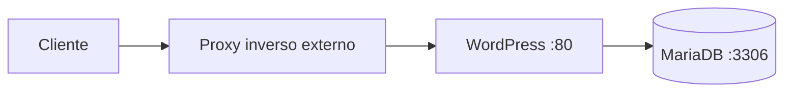

# JFStack WordPress

Despliegue endurecido de WordPress y MariaDB mediante imágenes oficiales, secretos por archivo, redes aisladas, rootfs de solo lectura, límites de recursos y copias de seguridad verificadas. Es autónomo y compatible con cualquier proxy inverso.

> URL del repositorio independiente pendiente: `<URL_PENDIENTE_REPOSITORIO_WORDPRESS>`

## Arquitectura



| Componente | Imagen | Exposición |
| --- | --- | --- |
| WordPress | `wordpress:7.1-php8.3-apache` | Red externa del proxy o puerto de host opcional |
| MariaDB | `mariadb:11.4` | Solo red interna `backend`; nunca se publica |

El Compose base no publica puertos. El override opcional publica únicamente WordPress y elimina la dependencia de la red externa.

## Requisitos

- Linux con Docker Engine y Docker Compose **2.24.4 o posterior**.
- OpenSSL, `flock`, `gzip`, `tar` y `sha256sum`.
- DNS y un proxy inverso con HTTPS.
- Capacidad y límites ajustados a los plugins, tráfico y tamaño de base reales.

## Instalación

```bash
git clone <URL_PENDIENTE_REPOSITORIO_WORDPRESS> jfstack-wordpress
cd jfstack-wordpress
make init
```

El inicializador crea `.env`, dos contraseñas independientes y permisos `0600`. No crea ni cambia redes de terceros. Revisa como mínimo:

```dotenv
WORDPRESS_PUBLIC_URL=https://wordpress.example.com
WORDPRESS_TRUST_PROXY_HEADERS=true
```

`WORDPRESS_PUBLIC_URL` fija `WP_HOME`, `WP_SITEURL` y, cuando usa HTTPS, `FORCE_SSL_ADMIN`. No incluyas una barra final.

## Elegir la conexión al proxy

### Proxy como contenedor Docker

La modalidad base conecta WordPress a una red Docker externa configurable, sin puertos de host:

```bash
docker network create proxy-wordpress        # omite si ya existe
sed -i 's/^PROXY_NETWORK=.*/PROXY_NETWORK=proxy-wordpress/' .env
make config
make up
```

Conecta el proxy a la misma red y reenvía a `http://wordpress:80`. El nombre de la red es libre y no existe dependencia del Traefik de JFStack ni de sus labels.

### Proxy en el host

El override enlaza WordPress a loopback y no necesita una red externa:

```bash
make config-publish
make up-publish
```

El proxy local debe alcanzar `http://127.0.0.1:8080`. Para otros comandos usa `COMPOSE_FILE=compose.yaml:compose.publish.yaml`, por ejemplo:

```bash
COMPOSE_FILE=compose.yaml:compose.publish.yaml make ps
COMPOSE_FILE=compose.yaml:compose.publish.yaml make update
```

### Proxy en otra máquina

Configura una IP privada concreta del host Docker:

```dotenv
PUBLISH_IP=10.20.0.15
WORDPRESS_PUBLISHED_PORT=8080
```

No uses `0.0.0.0`. Permite el puerto únicamente desde la IP privada del proxy mediante firewall. MariaDB no debe publicar `3306` bajo ninguna modalidad.

Los ejemplos opcionales de Nginx, Caddy y Traefik están separados en [docs/proxy-examples.md](docs/proxy-examples.md).

## HTTPS y cabeceras reenviadas

El proxy debe reemplazar `X-Forwarded-Proto` con `https`, conservar `Host` y construir de forma segura `X-Forwarded-For`. El stack interpreta `X-Forwarded-Proto` solo cuando `WORDPRESS_TRUST_PROXY_HEADERS=true`.

Activa esa variable únicamente cuando el proxy sea el único origen que puede alcanzar WordPress: controla qué contenedores se conectan a `PROXY_NETWORK`, usa loopback para un proxy local o aplica firewall para uno remoto. WordPress no ofrece por sí mismo una lista universal de proxies confiables; esa frontera se aplica en red.

## Despliegue y operación

```bash
make config
make up
make ps
make logs
```

Completa el instalador web en `WORDPRESS_PUBLIC_URL`, elimina temas y plugins sin uso y activa actualizaciones de seguridad acordes con tu política. Para detener sin borrar datos:

```bash
make down
```

No uses `docker compose down -v` salvo que quieras destruir el contenido y la base de datos.

## Actualización

Haz una copia, revisa compatibilidad de WordPress, PHP, MariaDB, temas y plugins, y después ejecuta:

```bash
make backup
make update
```

En modalidad publicada, antepone `COMPOSE_FILE=compose.yaml:compose.publish.yaml`. Las actualizaciones mayores de MariaDB requieren un plan de migración/restauración probado y no deben mezclarse con otros cambios mayores.

## Copias de seguridad y restauración

```bash
make backup
```

El script crea un dump comprimido de MariaDB, un archivo del volumen WordPress y un manifiesto SHA-256. `BACKUP_DIR` cambia el destino y `BACKUP_RETENTION_DAYS` la retención:

```bash
BACKUP_DIR=/srv/backups/wordpress BACKUP_RETENTION_DAYS=30 make backup
```

Conserva una copia cifrada fuera del host y verifica el manifiesto. Para restaurar, usa un entorno aislado: verifica hashes, restaura primero el archivo WordPress sobre un volumen vacío, importa el SQL con `mariadb` y comprueba URL, plugins, uploads y login antes del corte. No hay un script automático de restauración deliberadamente: el proceso es destructivo y debe adaptarse al destino. Documenta y ensaya tu procedimiento.

## Hardening y compatibilidad

- Capacidades eliminadas y solo las mínimas restauradas a los entrypoints oficiales.
- `no-new-privileges`, rootfs de solo lectura y `tmpfs` restringidos.
- Límites de PIDs, RAM/CPU y logs rotativos.
- Contraseñas en archivos ignorados por Git.
- PHP, Apache y MariaDB incluyen ajustes restrictivos versionados en `config/`.

Algunos plugins necesitan funciones PHP deshabilitadas en `config/php/uploads.ini`. Habilita solo la función concreta tras revisar el plugin. Este stack complementa, no reemplaza, el hardening del host, WAF, monitorización, 2FA y una política de actualizaciones.

## Desarrollo y CI

Consulta [CONTRIBUTING.md](CONTRIBUTING.md) y [SECURITY.md](SECURITY.md). El workflow autónomo vive en `.github/workflows/validate.yml`; GitHub solo lo activará cuando este contenido pase a la raíz del nuevo repositorio. Mientras permanezca en el monorepo, la CI de la raíz conserva las validaciones.

## Licencia

MIT. Consulta [LICENSE](LICENSE). Se conservan la identidad y atribución de JFStack.
