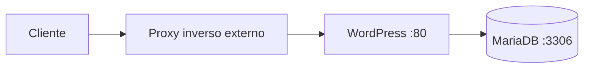

# JFStack WordPress

Despliegue endurecido de WordPress y MariaDB mediante imágenes oficiales, secretos por archivo, redes aisladas, rootfs de solo lectura, límites de recursos y copias de seguridad verificadas. Es autónomo y compatible con cualquier proxy inverso.

> URL del repositorio independiente pendiente: `<URL_PENDIENTE_REPOSITORIO_WORDPRESS>`

## Arquitectura



| Componente | Imagen | Exposición |
| --- | --- | --- |
| WordPress | `wordpress:7.1-php8.3-apache` | Red del proxy y puerto de host |
| MariaDB | `mariadb:11.4` | Solo red interna `backend`; nunca se publica |

El único archivo `compose.yaml` publica WordPress en `127.0.0.1:8080` por defecto y conecta la base de datos a una red interna. La red frontal puede ser externa o administrada por Compose.

## Requisitos

- Linux con Docker Engine y Docker Compose **2.24.4 o posterior**.
- OpenSSL, `flock`, `gzip`, `tar` y `sha256sum`.
- DNS y un proxy inverso con HTTPS.
- Capacidad y límites ajustados a los plugins, tráfico y tamaño de base reales.

## Instalación

```bash
git clone <URL_PENDIENTE_REPOSITORIO_WORDPRESS> jfstack-wordpress
cd jfstack-wordpress
./scripts/init.sh
```

El inicializador crea `.env`, dos contraseñas independientes y permisos `0600`. No crea ni cambia redes de terceros. Revisa como mínimo:

```dotenv
WORDPRESS_PUBLIC_URL=https://wordpress.example.com
WORDPRESS_TRUST_PROXY_HEADERS=true
```

`WORDPRESS_PUBLIC_URL` fija `WP_HOME`, `WP_SITEURL` y, cuando usa HTTPS, `FORCE_SSL_ADMIN`. No incluyas una barra final.

## Elegir la conexión al proxy

### Proxy como contenedor Docker

Para un proxy en Docker, usa una red externa y configúrala en `.env`:

```bash
docker network create proxy-wordpress        # omite si ya existe
```

```dotenv
PROXY_NETWORK=proxy-wordpress
PROXY_NETWORK_EXTERNAL=true
```

Conecta el proxy a esa red y reenvía a `http://wordpress:80`. También estará disponible `127.0.0.1:8080` en el host; restringe el acceso local según tu modelo de seguridad.

### Proxy en el host

Para no depender de una red externa, configura en `.env` un nombre exclusivo para la red administrada por Compose:

```dotenv
PROXY_NETWORK=compose-hardening-wordpress-frontend
PROXY_NETWORK_EXTERNAL=false
PUBLISH_IP=127.0.0.1
WORDPRESS_PUBLISHED_PORT=8080
```

El proxy local debe alcanzar `http://127.0.0.1:8080`. Usa los mismos comandos de despliegue en ambas modalidades.

### Proxy en otra máquina

Configura la red administrada por Compose como en el apartado anterior y una IP privada concreta del host Docker:

```dotenv
PUBLISH_IP=10.20.0.15
WORDPRESS_PUBLISHED_PORT=8080
```

No uses `0.0.0.0`. Permite el puerto únicamente desde la IP privada del proxy mediante firewall. MariaDB no debe publicar `3306` bajo ninguna modalidad.

Los ejemplos opcionales de Nginx, Caddy y Traefik están separados en [docs/proxy-examples.md](docs/proxy-examples.md).

## Migración desde dos archivos Compose

Conserva `COMPOSE_PROJECT_NAME`, `.env`, `secrets/` y los volúmenes existentes. Retira cualquier `COMPOSE_FILE` que incluya `compose.publish.yaml`, tanto de `.env` como del entorno. Si antes usabas el archivo de publicación, configura `PROXY_NETWORK_EXTERNAL=false` y un `PROXY_NETWORK` exclusivo, como en el ejemplo del proxy en el host. Si usabas la red externa, conserva su nombre y `PROXY_NETWORK_EXTERNAL=true`. El Compose unificado publica ahora WordPress en loopback también en la modalidad de red externa. Revisa el puerto y la frontera de confianza antes de recrear el servicio con `./deploy.sh start`; no cambies el nombre del proyecto ni uses `down -v`.

## HTTPS y cabeceras reenviadas

El proxy debe reemplazar `X-Forwarded-Proto` con `https`, conservar `Host` y construir de forma segura `X-Forwarded-For`. El stack interpreta `X-Forwarded-Proto` solo cuando `WORDPRESS_TRUST_PROXY_HEADERS=true`.

Activa esa variable únicamente cuando el proxy sea el único origen que puede alcanzar WordPress: controla qué contenedores se conectan a `PROXY_NETWORK`, usa loopback para un proxy local o aplica firewall para uno remoto. WordPress no ofrece por sí mismo una lista universal de proxies confiables; esa frontera se aplica en red.

## Despliegue y operación

```bash
docker compose config --quiet
./deploy.sh start
./deploy.sh status
./deploy.sh logs
```

Completa el instalador web en `WORDPRESS_PUBLIC_URL`, elimina temas y plugins sin uso y activa actualizaciones de seguridad acordes con tu política. Para detener sin borrar datos:

```bash
./deploy.sh stop
```

No uses `docker compose down -v` salvo que quieras destruir el contenido y la base de datos.

## Actualización

Haz una copia, revisa compatibilidad de WordPress, PHP, MariaDB, temas y plugins, y después ejecuta:

```bash
./scripts/backup.sh
./scripts/update.sh
```

Las actualizaciones mayores de MariaDB requieren un plan de migración/restauración probado y no deben mezclarse con otros cambios mayores.

La etiqueta `wordpress:7.1-php8.3-apache` recibe actualizaciones, pero un `up` normal puede reutilizar una imagen antigua. `./scripts/update.sh` descarga las imágenes y comprueba PHP antes de recrear los contenedores; el arranque también rechaza PHP anterior a 8.3.36. Tras actualizar, comprueba el intérprete realmente instalado:

```bash
docker compose exec wordpress php -v
docker compose exec wordpress php -r 'echo "session.upload_progress.enabled=", ini_get("session.upload_progress.enabled"), PHP_EOL;'
```

PHP 8.3.36 corrige CVE-2026-109618 y CVE-2026-109619. La configuración también desactiva el progreso de subida de sesión, según el aviso de PHP para CVE-2026-115560. El mínimo es una protección frente a estos avisos, no garantiza que se hayan corregido vulnerabilidades posteriores: revisa los [avisos oficiales de PHP](https://www.php.net/archive/2026.php) y vuelve a descargar imágenes con regularidad. PHP 8.3 termina su soporte de seguridad el 31 de diciembre de 2027; planifica una migración compatible antes de esa fecha.

El volumen `wordpress_data` conserva todo `/var/www/html`: descargar la imagen actualiza PHP, pero no sustituye el núcleo WordPress de una instalación existente. Actualízalo por el administrador de WordPress, junto con plugins y temas, después de comprobar compatibilidad y tener una copia. Revisa en el administrador que se haya aplicado la actualización de base de datos si se solicita. El núcleo incluido en la imagen se utiliza al inicializar un volumen nuevo.

La interfaz opcional `deploy.sh` / `deploy.ps1`, sus comandos y las diferencias de plataforma se describen en [docs/deploy/README.md](docs/deploy/README.md).

## Copias de seguridad y restauración

```bash
./scripts/backup.sh
```

El script crea un dump comprimido de MariaDB, un archivo del volumen WordPress y un manifiesto SHA-256. `BACKUP_DIR` cambia el destino y `BACKUP_RETENTION_DAYS` la retención:

```bash
BACKUP_DIR=/srv/backups/wordpress BACKUP_RETENTION_DAYS=30 ./scripts/backup.sh
```

Conserva una copia cifrada fuera del host y verifica el manifiesto. Para restaurar, usa un entorno aislado: verifica hashes, restaura primero el archivo WordPress sobre un volumen vacío, importa el SQL con `mariadb` y comprueba URL, plugins, uploads y login antes del corte. No hay un script automático de restauración deliberadamente: el proceso es destructivo y debe adaptarse al destino. Documenta y ensaya tu procedimiento.

## Hardening y compatibilidad

- Capacidades eliminadas y solo las mínimas restauradas a los entrypoints oficiales.
- `no-new-privileges`, rootfs de solo lectura y `tmpfs` restringidos.
- Límites de PIDs, RAM/CPU y logs rotativos.
- Contraseñas en archivos ignorados por Git.
- PHP, Apache y MariaDB incluyen ajustes restrictivos versionados en `config/`.

Algunos plugins necesitan funciones PHP deshabilitadas en `config/php/uploads.ini`. Habilita solo la función concreta tras revisar el plugin. Este stack complementa, no reemplaza, el hardening del host, WAF, monitorización, 2FA y una política de actualizaciones.

## Desarrollo y CI

Consulta [SECURITY.md](SECURITY.md). El workflow de validación está en `.github/workflows/validate.yml`.

## Licencia

MIT. Consulta [LICENSE](LICENSE). Se conservan la identidad y atribución de JFStack.
